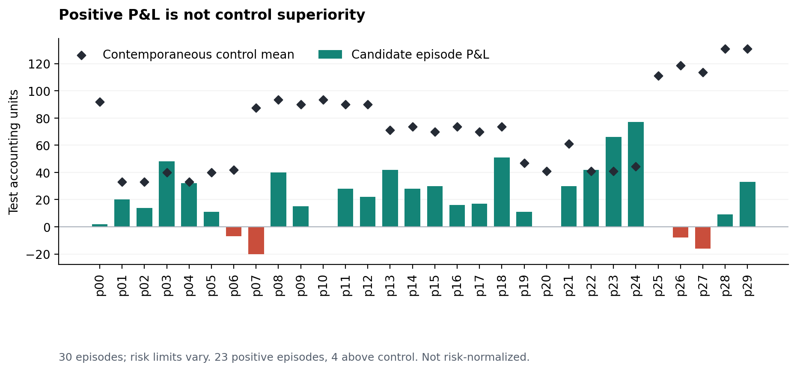
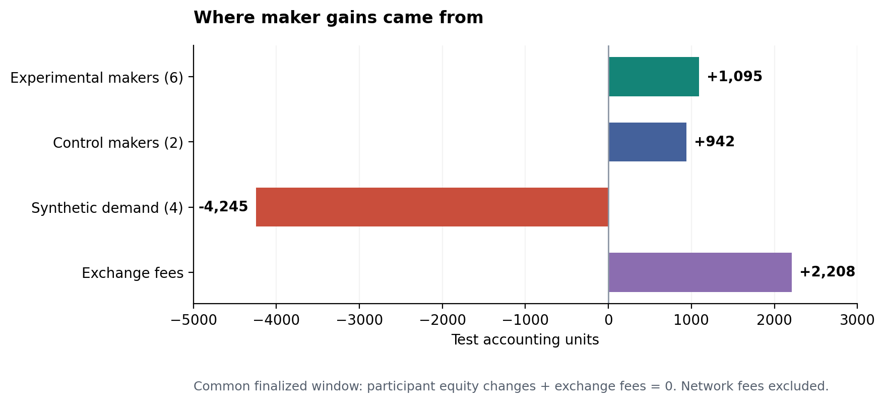
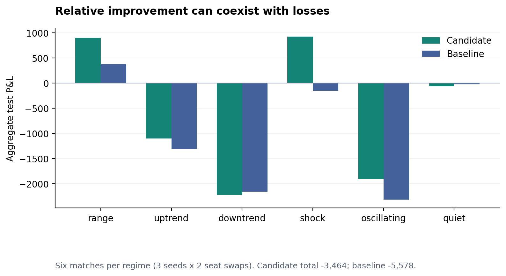

# Fast Machines, Endogenous Losses

## Strategy Evolution in Agent-Native Perpetual Markets

**SKEW Research · Working paper v0.1 · 9 October 2026**

This is an empirical systems and mechanism-design study. It is not peer reviewed.
Results describe controlled experiments; the terms *agent*, *strategy* and
*evolution* do not imply general intelligence or profitable autonomous trading.

### Abstract

We study an execution architecture in which a frozen language model proposes
bounded strategies, a native Economic Machine runtime reacts to market events,
and an on-chain orderbook authoritatively matches and accounts for trades. The
architecture separates slow policy search from fast execution and makes the
distribution of trading losses observable. Solana development-network experiments
include a six-hour twelve-agent session, thirty personalized strategy episodes,
and thirty-two-actor competitive SBF simulations. A separately bounded Arbitrum
One pilot validates small real-collateral settlement. Native personalized decisions
measure 5.447 microseconds at the median, excluding network and chain latency.
However, 23 of 30 development episodes showing positive P&L translates into only
4 of 30 outperforming contemporaneous baseline makers. In a shared observation
window, experimental makers gain 1,095 units, control makers gain 942, synthetic
demand loses 4,245, and fees gain 2,208: the sum is zero. In paired simulations,
the candidate beats the baseline in 23 of 36 matches while both lose in aggregate.
These results establish executable personalization and auditable transfers, not
external alpha. We argue that machine-market research must evaluate loss incidence,
matched risk, execution costs and settlement correctness separately from raw
decision speed.

### 1. Research question

An exchange populated by trading agents can appear successful for two different
reasons. Its software may execute reliably, or a selected agent may earn money.
Neither implies that the mechanism benefits all users. A market maker's positive
P&L can be financed by a predictable synthetic taker; a strategy can outperform
another strategy while still losing; a fast policy can spend its edge on fees.

We ask three narrower questions. Can an LLM-generated strategy be represented as
bounded numeric data and executed without inference on every event? Can that
strategy be adapted to different owner preferences without editing the accounting
or granting itself more capital? When measured agents win, can we account for who
loses and distinguish a better pilot from a favorable test population?

Our contribution is a connected implementation and a set of negative as well as
positive observations. This is an exploratory case study, not a randomized trial
or a universal throughput comparison. The Solana and Arbitrum experiments have
different capital, participant and time scales and are not a chain performance
race.

### 2. Three clocks and three authorities

The proposer, executor and settlement engine operate on different clocks.

The frozen proposer is `meta/muse-spark-1.3-contributor`. It receives permitted
development-market aggregates and produces an acyclic numeric strategy graph with
at most forty nodes. The six features represent inventory, imbalance, momentum,
volatility, depth and age. The four outputs represent skew, spread, clip and
action. The cold validator checks shape, types, interval bounds and backward-only
references. Output is data rather than executable Python, shell or arbitrary
native code. Model weights are never updated in these experiments.

The native Economic Machine interpreter installs the accepted graph under an
immutable profile. The original adapter evaluated one graph four times, once for
each output. A fused adapter evaluates it once and encodes all 14,553 permitted
output tuples exactly within the upstream fixed-point scale. Native code applies
the owner's position, quote-size and spread limits. Event processing performs no
model call, JSON parsing, database query or C++ heap allocation in the measured
decision path. Installation and durable profile writes are outside that path.

The orderbook remains authoritative. Nonce, session scope, expiry, oracle
freshness, collateral and matching checks are not delegated to the model. A
candidate decision carries zero signing authority. The controller binds an
authorized mandate, journals exact signed bytes before transmission and reconciles
ambiguous outcomes. A new strategy cannot reset a nonce, reopen a budget or
replace an unknown transaction with a fresh signature.

This separation is why microsecond execution is possible without claiming
microsecond reasoning by Muse. Model generation is a cold research activity;
published native timings exclude inference, signing, RPC, inclusion and finality.
The architecture draws on explicit state/queue organization, rather than claiming
to reproduce a validator such as Firedancer [1].

### 3. Chain-specific market mechanisms

#### 3.1 Solana

The wide development layout uses 256 seats, 4,096 order slots and a 549,440-byte
fixed market arena. Bitmap price discovery and intrusive FIFO avoid general
allocation and pointer-heavy trees. Quote frames replace a bounded set of orders;
IOC traversal has an explicit visit limit. Integer ticks/lots and isolated margin
keep accounting exact. Shared observations can be scanned once and supplied to
many native policy instances.

One market is still one shared writable account. Saving compute units does not
remove that write lock or establish public-network TPS. v6 is the deployed
development version. v7 is an undeployed candidate: it corrects fragmented IOC
fee rounding, caches maker funding/risk geometry, and introduces an external-feed
initialization layout. Candidate measurements are never attributed to the v6
live program. Production-mode oracle tests use receiver fixtures; plain
six-decimal SPL collateral is not automatically USDC or Token-2022 support.

#### 3.2 Arbitrum

The EVM implementation packs cash, inventory, nonce and risk-index position into
one storage word, with funding in a second word. Packed commands, bounded FIFO
visits and atomic multi-account quote updates reduce repeated reads and calldata.
A global solvency index prevents apparently flat accounts from withdrawing
against a latent market deficit. A C++ coordinator emits commands for separate
profile scopes and suppresses a quote only when actual state and remaining TTL
justify it.

Arbitrum costs include execution and parent-chain posting; Anvil execution gas
alone is not total Nitro cost [3]. The published pilot uses a deterministic
inventory/momentum policy, not a new Arbitrum Muse-evolution run. The two chain
engines share economic primitives, not an assertion of identical on-chain
execution semantics.

### 4. Evaluation and personalization

Profiles contain immutable risk limits, objective weights, a style, a user
namespace and a revision hash. Changing preferences appends a revision with a
parent hash rather than rewriting history. Candidate/evaluation identities and
consumed observation ranges are attached to that revision. Compare-and-swap
updates prevent concurrent edits from silently replacing one another.

The evaluator considers funding-adjusted P&L, drawdown, inventory, adverse
markout, turnover, estimated fills, quote churn and stressed exit cost. Normal
and stressed queue/delay assumptions are compared. Input records must be ordered,
accounting-verified and sourced from finalized observations. Holdout records must
be after proposal completion and a purge boundary; already-consumed windows are
rejected. Training mode cannot enter promotion history.

These guards reduce obvious leakage but do not create an external holdout.
Snapshot depth and aggregated IOC records produce counterfactual fill estimates,
not an exact reconstruction of queue position. The controlled market may favor
the same agents that generated its observations. Research eligibility is distinct
from owner-authorized experimental deployment and from permanent promotion.

A canary handoff cancels orders, reconciles pending signatures and reaches a flat
seat before installing the next strategy. The experiment keeps two unchanged
baseline maker roles. It preserves wallets, original session scope, limits and
journals. Native profile history is a trusted local SQLite ABI with durable
commits; its checksums detect corruption, not a malicious host rewriting both
data and checksum.

### 5. Experimental design

The experiments were run on a shared Canadian Linux host with an Intel Xeon
E-2386G. Native evaluation measurements used CPU affinity and warm-up. They are
machine-specific observations, not upper bounds or isolated-hardware guarantees.

| Experiment | Population and design | What it measures |
| --- | --- | --- |
| E1: six-hour devnet | 8 makers, 4 synthetic demand agents, keeper | Connected execution and settlement |
| E2: personalized devnet | 6 Muse candidates × 5 styles; 30 sequential 90-second episodes on 6 roles; 2 control makers | Feasible handoff and contemporaneous descriptive P&L |
| E3: competitive SBF | Candidate + baseline + 30 opponents; 6 price regimes × 3 seeds × 2 seat swaps; 60 steps | Paired synthetic relative performance |
| E4: offline optimization | Identical-input SBF/Anvil and native tests | CU, gas, state equivalence and local latency |
| E5: followup settlement | Solana 30-minute reuse; Arbitrum 6 agents, ≤5 USDC and ≤0.001 ETH | Bounded real-chain lifecycle |

E2's thirty settings are not thirty independently trained models. E3's thirty
opponents are different: six behavioral families crossed with five risk styles.
Opponents use then-available fair-value and fee conditions; they are not assigned
a predetermined loss. Seat swaps preserve the price path/seed and exchange pilot
positions in the order schedule. Matches and episodes share candidates and
market mechanisms; treating all rows as independent samples would be unjustified.

The strategy-generation budget reserved twelve calls. Eight responses were recorded, six valid
candidates were evaluated, two responses were invalid, three calls timed out and
one outcome remained unknown after restart. One research champion change occurred.
Provider-reported usage total was USD 0.0043695, not an invoice; USD 0.027392 was
the reservation ceiling and USD 0.008448 remained reserved for four unconfirmed
outcomes. We do not silently count timeouts as free or successful responses.

### 6. Results

#### 6.1 Fast execution, with a narrow timing boundary

Twenty thousand warmed decisions measured native personalized p50 **5.447 µs**
and p99 **7.837 µs**. Python boundary/conversion increased these to **10.785 µs**
and **19.819 µs**. A prepared sixty-frame evaluation decreased from **1.626817 ms**
to **0.343573 ms**, a ratio of approximately **4.73×**. First window preparation
cost **0.628801 ms**; charging all preparation to the first evaluation gives
approximately **1.67×**, not 4.73×. Profile revision append measured p50
**0.568081 ms** and p99 **5.387369 ms**. Persistence is intentionally not a tick
operation. See [Table T4](tables/native_latency.csv).

For 256 v7 policy instances, shared scan, policy evaluation and checkpoints
measured p50 3.984 ms and p99 5.942 ms, including Python boundary cost. This is
one observed processing pipeline, not per-agent latency or network throughput.

#### 6.2 Positive P&L is not baseline superiority

All thirty E2 settings submitted nonempty finalized quote updates; all six roles
returned to their original strategy. Twenty-three episodes were profitable,
four lost and three were flat. Total P&L was **+633 test accounting units**,
while summed excess over the contemporaneous mean control maker was
**−1,536.5**. Only **4/30** exceeded that comparator.

*Figure 1. Episode P&L and the contemporaneous control-maker mean. Risk limits
vary across settings; these are descriptive, not risk-normalized treatment
effects. Episode sums are not a whole-session conservation window.*

The striking contrast is 76.7% positive episodes against 13.3% baseline wins.
It demonstrates that “profitable in our market” is a weak acceptance rule. The
control gets the same time window but is not an identical-risk randomized
counterfactual: role, queue priority, style and capital exposure differ. We do
not infer statistical significance or a causal loss from personalization.

#### 6.3 Who loses?

At common finalized endpoints spanning slots 508532341–508534842, experimental
maker equity changes total **+1,095**, control makers **+942**, synthetic demand
**−4,245**, and exchange fees **+2,208**. Their sum is **0**. This observation
includes some pre/post-episode baseline time, so it must not be added to E2's
individual episode sum.

*Figure 2. The accounting identity exposes the source of maker gains. Test units
are neither USD nor SOL; network costs are outside this internal transfer sum.*

For a closed collateral system at common endpoints, a useful identity is

$$\sum_i \Delta E_i + \Delta I = D-W+C_{\mathrm{external}},$$

where $E_i$ includes collateral, marked price P&L and funding, $I$ is the
fee/insurance account, $D-W$ is net trader deposits and $C_{\mathrm{external}}$ is separately
supplied recapitalization. With no external flow in the E2 observation window,
the right-hand side is zero. A positive agent result therefore needs an incidence
explanation. This is an accounting identity, not a welfare theorem: risk transfer,
liquidity service or utility benefits can exist without increasing collateral.

#### 6.4 Relative improvement can still be aggregate loss

In E3, the candidate beats the baseline in **23/36** paired matches. Candidate
P&L sums to **−3,464**, baseline P&L to **−5,578**; the relative difference is
**+2,114**. All thirty-six matches settle and conserve participant P&L plus fees.
The candidate reduces losses within this population but does not establish
absolute profitability. Regime/seed/seat-swap rows are published in
[Table T2](tables/paired_matches.csv), not raw VM logs.

*Figure 3. Aggregated candidate and baseline P&L by regime, six matches each.
Relative performance and absolute returns are different acceptance criteria.*

#### 6.5 Compute savings are path dependent

The v7 same-maker buy-eight path falls from 19,480 CU in the fee-corrected baseline
to 18,064 CU, a 7.27% reduction. A one-maker buy increases from 6,217 to 6,306 CU.
An eight-distinct-maker buy costs 27,801 CU versus 17,285 for the rebuilt Phoenix
comparison. Selected quote/cancel paths are cheaper in this harness, but some
matching paths are more expensive. [Table T5](tables/solana_cu.csv) reports all
eleven compared paths.

Phoenix is a spot orderbook with atomic settlement [2]. The comparator retains
matching source but is an SDK-compatible rebuild, not official deployment bytes;
our engine performs perp accounting. Same instructions, fill count, direction
and platform constrain a path comparison; they do not establish equal functionality
or general superiority. Solana requested CU also differs from consumed CU [4].

Arbitrum's current same-safety partial fill uses 199,729 execution gas versus
204,262 immediately before the endpoint optimization. The 32-maker path uses
1,885,225 versus 2,031,718, a 7.21% reduction. Atomic thirty-account TTL replacement
uses 51.09% less gas than thirty separate updates in the matched Anvil experiment.
Those measurements use mock oracles and exclude an assertion about live Nitro
posting cost or public-chain latency.

#### 6.6 Settlement is separately demonstrated

E1 independently reconciles **39,242** successful runtime signatures and **80**
owner settlement receipts to finalized status. There are **10,673** positive IOC
receipts and **18,416** filled lots. Seventeen cancelled submissions were checked
as expired/not landed or failed; none remained unresolved. Final orders, positions
and seat collateral are zero and twelve delegated sessions are revoked. A
120-unit test-token supply equals 119.889444 withdrawn plus 0.110556 fee-vault units.
This is connected correctness, not customer volume.

The Solana followup separately records 860 positive competition IOC receipts and
1,507 lots. Final reconciliation includes 3,289 runtime journal rows and 60 owner
receipts, zero residual account state, unchanged original journals and 0.017015
devnet SOL in fees. Do not add journal rows, owner receipts and fill counts as if
they were the same kind of transaction.

The Arbitrum followup independently verifies **69** canonical/finalized receipts
at block **513084313**. There are ten positive competition fills and eleven lots
including closeout. The eleventh competitive IOC is empty, causing the bounded
controller to stop and settle; it is not an on-chain failed transaction. From
5 USDC deposited, 4.986323 returns and 0.013677 becomes the session fee. Existing
insurance of 0.004892 remains separately identified. Vault/insurance is therefore
0.018569. Account cash, positions, orders, sessions, allowance and bad debt are
zero and the market is paused. Gas plus agent prefunding is 0.000401705560566 ETH,
inside the 0.001 ETH bound. Journal preservation and finality are verified before
the experiment is called settled.

### 7. Shock losses and exit rights

The simulator's closed-system identity does not make bankruptcy disappear.
Solana v7 tests settle 256 positions/4,096 orders under stress; insurance shortfall
is allocated by a terminal proportional haircut of positive unrealized claims.
This is not risk-ranked pairwise ADL.

Arbitrum's thirty fixed risk profiles across seven independent price shocks
yield 210 account/scenario comparisons with zero ledger discrepancy and 45
liquidations. These are fixed risk configurations, not thirty invented AI strategies.
At ±20% and ±30%, some branches require external recapitalization and withdrawals
stop, including uninvolved flat depositors. At −30% the required outside amount is
3,572.493 test collateral units; at +30% it is 3,567.507. The experiment supplies
that capital explicitly before testing exits. It is not endogenous profit or
automatic recovery. [Table T6](tables/shocks.csv) preserves all seven branches.

Earlier attack regressions motivated three changes: blocking withdrawals against
latent loss, capping liquidation compensation by positive equity, and rounding
fees on cumulative IOC notional. The lesson is that optimization must preserve
the same loss-allocation rule. Lower gas from omitting a solvency check is a
different mechanism, not an efficiency gain.

### 8. Interpretation and next experiments

Fast reaction, strategy diversity and trustworthy exits are separate attributes.
The observed policy execution cost is small enough to move inference out of the
tick loop. The observed loss distribution gives no reason to market those policies
as independently profitable. A market that “teaches” its own strategies may select
for its own synthetic opponents rather than outside robustness.

Personalization should therefore optimize an explicit owner utility under matched
risk, for example P&L minus weighted drawdown, inventory, adverse selection and
churn. The utility weights should not be tuned after viewing a held-out result.
Different users may rationally prefer different loss distributions; maximizing
raw P&L for all profiles erases that distinction.

A stronger next experiment would preregister equal risk/capital budgets, randomize
role and queue assignment, reserve longer never-reused market windows, and report
net returns after a supplied conversion of network fees. Independent participants
and reference prices should replace self-generated demand. Matched paths should
include adverse-selection markouts, drawdowns, exit availability and the source
of insurance capital. End-to-end timing must measure observation-to-signed-command,
inclusion and finality separately. No additional trade or model budget was opened
to prepare this paper.

### 9. Reproducibility and limitations

The companion engine source includes both measured chain implementations and the
undeployed Solana candidate, plus numeric test fixtures and portable offline
builds. [Methods](methods/README.md) specifies each table's unit, population,
comparison and aggregation. The analysis script independently verifies the
published accounting sums and regenerates the figures from curated tables.
Source hashes and public chain references are in
[provenance](methods/provenance.json).

The publication omits operational SQLite journals, raw signed bytes, private
profiles, API responses and credentialed endpoints. Table reproduction is not
reproduction of the historical live run. Public transaction examples can be
looked up independently; aggregate historical receipt counts remain supported by
the archived operator reconciliation, not by a hash-only proof of truth. Published
source hashes bind source identity, not external economic validity.

The study has a small real-capital pilot, synthetic demand, short personalized
episodes, correlated observations, selection effects and no independent external
profitability sample. Counterfactual fills are approximations; risk budgets differ
across E2 settings; gas tests are not public-chain throughput tests. Oracle values,
keepers, backstop availability and full public-congestion behavior are not proven
by an accounting test. We make no equilibrium, significance, audit-completion or
production-readiness claim.

### References

1. Firedancer contributors. [Firedancer source and tiled execution architecture](https://github.com/firedancer-io/firedancer). Design reference, not code-equivalence evidence.
2. Ellipsis Labs. [Phoenix v1 source](https://github.com/Ellipsis-Labs/phoenix-v1), compared matching source commit `5a34f7f901fd9e04057198d4fc7b7286f78b53f2`.
3. Offchain Labs. [Arbitrum gas and fees](https://docs.arbitrum.io/how-arbitrum-works/gas-fees). Primary reference for execution/posting cost separation.
4. Solana Foundation. [Transaction fees](https://solana.com/docs/core/fees). Primary reference for requested compute budgets and fee accounting.
5. SKEW. [Economic Machine](https://github.com/skew-labs/economic-machine), native runtime snapshot `8e0af06cba5d42254a761915b93f0d4d89a951b3`.
